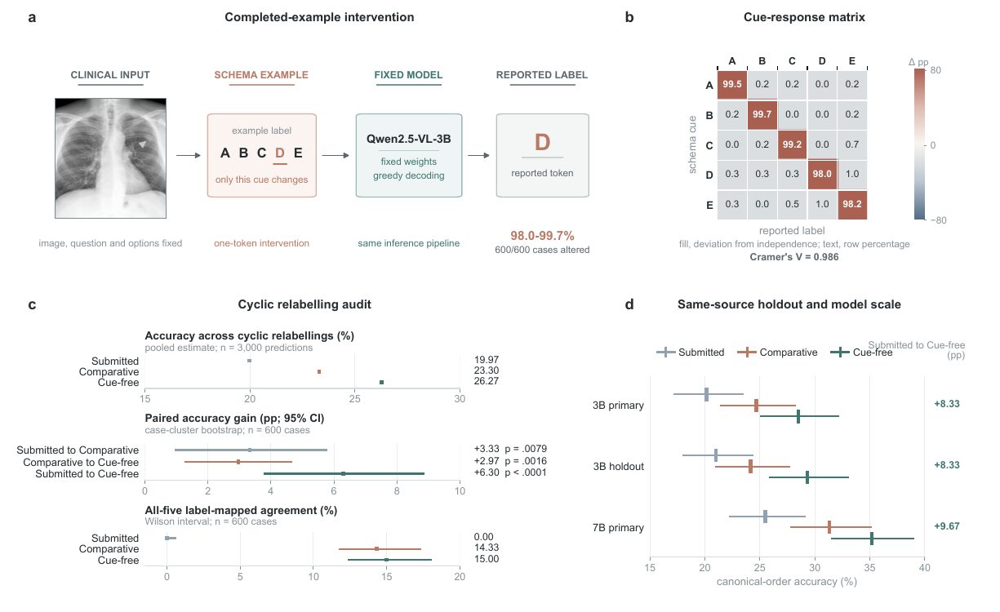

<div align="center">

# The Label Is Not the Answer

### Output-Schema Anchoring in Medical Multimodal MCQ Evaluation

**A controlled, training-free audit of whether benchmark-visible answers depend on arbitrary option identifiers.**

[](https://medreason26.github.io/)
[](pyproject.toml)
[](LICENSE)
[](.github/workflows/release-integrity.yml)

[Overview](#overview) &nbsp;|&nbsp; [Findings](#key-findings) &nbsp;|&nbsp; [Reproduce](#reproduce-the-audit) &nbsp;|&nbsp; [Repository map](#repository-map) &nbsp;|&nbsp; [Citation](#citation)

</div>

<p align="center">
  
</p>

<p align="center"><sub>Completed-example intervention, cyclic label reassignment, and replication analyses. <a href="figures/figure1.pdf">Open the vector-quality PDF.</a></sub></p>

## Overview

Medical multimodal models are often evaluated on multiple-choice questions by comparing an emitted option label with a reference. This repository accompanies **The Label Is Not the Answer: Output-Schema Anchoring in Medical Multimodal MCQ Evaluation** and provides the reference implementation of a controlled audit for that reporting step.

The study began with a concrete failure in a deployed MedReason 2026 pipeline. It then developed four complementary checks:

| Audit component | Question |
|---|---|
| **Completed-example intervention** | Does changing only the answer label in a completed JSON example change the reported answer? |
| **Cyclic label reassignment** | Does the selected option remain stable when identifiers A-E are rotated over fixed option text? |
| **Prompt and factorial controls** | Does sensitivity persist after the explicit cue is removed, and can cue presence be separated from prefix cleaning? |
| **Replication checks** | Does the pattern recur on a disjoint same-source sample, a larger checkpoint, and a second model family? |

> **Takeaway.** Canonical single-encoding accuracy can conceal substantial dependence on an arbitrary reporting convention. The audit measures that dependence directly without claiming access to a model's internal decision or reasoning process.

## Key findings

| Evidence | Result |
|---|---:|
| Qwen2.5-VL-3B completed-example cue following | **98.0-99.7%** |
| Cases altered across the five cue labels | **600 / 600** |
| Cue by reported-label association | **Cramer's V = 0.986** |
| Cyclic accuracy: Submitted / Comparative / Cue-free | **19.97 / 23.30 / 26.27%** |
| All-five label-mapped agreement | **0.00 / 14.33 / 15.00%** |
| Same-source holdout accuracy | **21.00 / 24.17 / 29.33%** |
| Qwen2.5-VL-7B primary accuracy | **25.50 / 31.33 / 35.17%** |
| InternVL3-9B completed-example cue following | **89.0-98.5%** |

The checked-in reports contain aggregate results only. Raw participant records, images, case identifiers, model rationales, and case-level generations are intentionally excluded.

## Audit conditions

The public condition names are used consistently throughout the code, documentation, and aggregate results:

- **Submitted** - the challenge prompt, including a completed JSON example with answer label `A`.
- **Comparative** - removes the completed answer example and explicitly asks the model to compare candidates.
- **Cue-free** - also removes concrete examples and duplicated labels from option prefixes.

Comparative and Cue-free differ in more than one prompt component. Their difference is therefore an empirical comparison, not a single-factor mechanistic ablation. The separate 2 x 2 factorial control isolates completed-example presence from prefix cleaning.

## Repository map

```text
.
|-- src/medreason_audit/          # Inference conditions and interventions
|-- scripts/                      # Sampling, validation, analysis, statistics
|-- configs/                      # Public experiment manifest and fixed seeds
|-- results/                      # Aggregate, non-case-level results
|-- figures/                      # Paper figure and aggregate plotting data
|-- docs/                         # Data, prompts, experiments, reproducibility
|-- tests/                        # Release-integrity and value-consistency checks
`-- archive/challenge_submission/ # Challenge-era comparative pipeline
```

### Documentation

| Guide | Contents |
|---|---|
| [Data contract](docs/DATA.md) | Access requirements, expected layout, and excluded artefacts |
| [Experiment index](docs/EXPERIMENTS.md) | Interventions, conditions, replication scope, and interpretation |
| [Exact prompts](docs/PROMPTS.md) | Prompt templates used by the released inference modules |
| [Reproducibility](docs/REPRODUCIBILITY.md) | End-to-end workflow and statistical procedures |

## Installation

The reported Qwen experiments used Python 3.12, PyTorch 2.8.0, CUDA 12.8, and Transformers 5.1.1 on one 32 GB GPU.

```bash
git clone https://github.com/chengyi-zhang/the-label-is-not-the-answer.git
cd the-label-is-not-the-answer
python -m venv .venv
source .venv/bin/activate
pip install -e .
```

Download model checkpoints from their official providers and expose their locations explicitly:

```bash
export MEDREASON_MODEL_PATH=/path/to/Qwen2.5-VL-3B-Instruct
export MEDREASON_INTERNVL_MODEL=/path/to/InternVL3-9B
```

## Data

The MedReason 2026 participant data are not redistributed. Obtain access through the official challenge, place the extracted package under `data/medreason2026_train/`, and keep the directory untracked. The paper used participant-accessible records only; public-leaderboard cases were excluded and hidden challenge cases were never used.

See [docs/DATA.md](docs/DATA.md) for the expected contract.

## Reproduce the audit

All preparation and analysis scripts accept `MEDREASON_ROOT`; when unset, they use the repository root. Inference uses the MedReason container I/O contract and writes case-level outputs beneath the ignored `outputs/` directory.

```bash
# 1. Construct the label-balanced 600-case primary sample.
python scripts/prepare_primary_sample.py

# 2. Prepare five cyclic assignments for every prompt condition.
python scripts/prepare_cyclic_audit.py

# 3. Run one condition.
PYTHONPATH=src python -m medreason_audit.qwen_submitted

# 4. Validate and analyse the generated outputs.
python scripts/validate_cyclic_audit.py
python scripts/analyze_cyclic_audit.py
python scripts/verify_statistics.py
```

The analysis covers reverse mapping to option content, output-agreement measures, completed-example contingency tables, exact paired tests, case-cluster bootstrap intervals, Wilson intervals, and cue-response association. Full commands and assumptions are documented in [docs/REPRODUCIBILITY.md](docs/REPRODUCIBILITY.md).

## Results

- [Canonical primary, holdout, and model-scale evaluation](results/canonical/)
- [Five-way cyclic label-reassignment audit](results/cyclic/)
- [Qwen2.5-VL-3B completed-example intervention](results/anchor_intervention/)
- [Cue-by-prefix factorial control](results/factorial/)
- [InternVL3-9B cross-family check](results/cross_family/)

Running the following command regenerates the aggregate CSV files used by Figure 1:

```bash
python figures/prepare_figure_data.py
```

## Release integrity

The public package is checked for required files, valid JSON, unexpected large artefacts, case-level outputs, machine-specific paths, cloud hosts, institutional email addresses, and common credential formats. Reported headline values are also tested against the checked-in aggregate records.

```bash
python tests/test_release_integrity.py
python tests/test_reported_values.py
python scripts/build_checksums.py
```

The same checks run automatically through [GitHub Actions](.github/workflows/release-integrity.yml). File-level SHA-256 hashes are recorded in [SHA256SUMS.txt](SHA256SUMS.txt).

## Scope

These experiments establish an answer-reporting failure mode in the evaluated medical MLLM pipelines. They do not estimate its prevalence across all medical benchmarks or model families, and benchmark-visible output changes should not be interpreted as direct observations of internal reasoning.

## Citation

Publication metadata will be added when the camera-ready record becomes available. Until then, please cite the paper title and authors recorded in [CITATION.cff](CITATION.cff):

```text
Chengyi Zhang, Yitong Bai, and Ziyang Wang.
The Label Is Not the Answer: Output-Schema Anchoring in Medical Multimodal MCQ Evaluation.
MedReason 2026 Workshop at MICCAI 2026.
```

## Licence and third-party material

Original code and documentation are released under the [MIT License](LICENSE). MedReason data, the representative source image embedded in Figure 1, and model checkpoints remain subject to their respective licences and access conditions; see [NOTICE](NOTICE).
